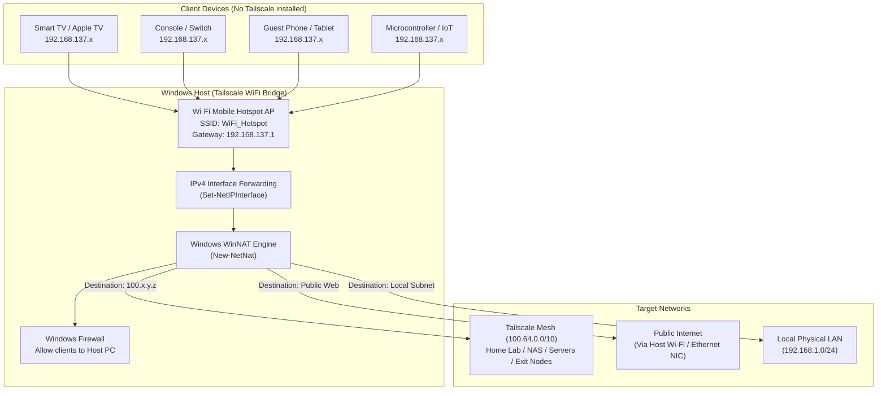

# Tailscale WiFi Bridge

Turn any Windows 10/11 PC into an ad-hoc Wi-Fi Access Point and transparent L3 NAT gateway that bridges client devices directly into your private [Tailscale](https://tailscale.com) network (Tailnet), local LAN, and the Internet.

Connected devices require **no Tailscale client installation, no configuration profiles, and no root/jailbreak**.

---

## Use Cases

* **Unmanaged & IoT Devices:** Connect devices that cannot run Tailscale natively—such as Smart TVs, Apple TV, gaming consoles (PlayStation, Xbox, Nintendo Switch), microcontrollers (ESP32, Raspberry Pi Pico W), IP cameras, and network printers.
* **Travel Router Replacement:** When staying in hotels, Airbnbs, or using mobile hotspot tethering, turn your laptop into a portable travel router. All your companion devices connect to a single Wi-Fi SSID and immediately gain access to your home lab, NAS, internal DNS, and Tailscale Exit Nodes.
* **Guest & Lab Access:** Provide temporary Tailnet access to client or friend devices without having to invite their accounts into your Tailscale organization or install software on their phones.
* **Zero Tailscale Admin Approval:** Because the host PC acts as an outbound NAT gateway using its existing Tailscale identity, **no subnet routes (`--advertise-routes`) need to be approved** in your Tailscale admin console.

---

## Architecture & Packet Flow



---

## Features

- **Automated WinRT Tethering:** Manages the native Windows Mobile Hotspot service programmatically via the `Windows.Networking.NetworkOperators.NetworkOperatorTetheringManager` WinRT API.
- **Kernel-Level NAT Routing:** Sets up Windows WinNAT (`New-NetNat`) and toggles IPv4 forwarding across connected network interfaces.
- **Safe Self-Elevation & Dual-Engine PowerShell Bridge:** WinRT tethering projections in .NET are historically unstable or non-functional under PowerShell 7+ Core. This script detects when it is launched under PS7 or without elevation, securely passes credentials via memory/environment variables, and relaunches under elevated **Windows PowerShell 5.1**.
- **Conflict Detection:** Scans existing WinNAT configurations (such as WSL2, Docker Desktop, or Hyper-V Default Switch) and refuses to overwrite foreign NATs to prevent system networking disruption.
- **Stateful Teardown & Restoration:** Persists pre-existing interface forwarding flags to `%ProgramData%\TailscaleWiFiBridge\state.json`. When stopped, it restores the original interface forwarding states, removes the dynamic WinNAT prefix, deletes firewall rules, and cleanly stops tethering.
- **Host PC Access Firewall Control:** Automatically manages inbound firewall rules so connected devices can communicate with local development servers or fileshares hosted on the host laptop.

---

## Prerequisites

1. **Operating System:** Windows 10 (version 1809+) or Windows 11.
2. **Wi-Fi Adapter:** Wireless network adapter supporting Wi-Fi Direct / Hosted Network / Tethering (virtually all modern laptop Wi-Fi cards).
3. **Tailscale:** Tailscale for Windows installed, logged in, and in a **Running** state.
4. **Permissions:** Administrator access (the script automatically prompts for UAC elevation if launched unelevated).

---

## Quick Start

### 1. Launch with Default Settings

Open PowerShell and execute:

```powershell
.\Tailscale-WiFi-Bridge.ps1
```

By default, the script creates:
- **SSID:** `WiFi_Hotspot`
- **Password:** `12345678`
- **Host Access:** Enabled (clients can access services running on this PC)

### 2. Custom Wi-Fi Credentials via CLI

You can specify a custom SSID and secure passphrase directly:

```powershell
.\Tailscale-WiFi-Bridge.ps1 -SSID "MyPrivateBridge" -Password "SecretPassphrase123"
```

To isolate the host PC (prevent clients from accessing services running directly on the host laptop):

```powershell
.\Tailscale-WiFi-Bridge.ps1 -SSID "GuestTailnet" -Password "GuestPass123" -AllowAccessToThisPC $false
```

---

## Interactive Console Menu

When launched, the script presents an interactive dashboard:

```text
==========================================
        Tailscale WiFi Bridge             
==========================================

PowerShell      : 5.1.26100.2161
Administrator   : Yes

1. START hotspot + NAT routing
2. STOP hotspot + restore configuration
3. Show status / NAT sessions
4. Exit

------------------------------------------
Select an option (1-4):
```

### Options Overview:
* **`1. START hotspot + NAT routing`:**
  - Verifies prerequisites and active Tailscale connection.
  - Configures and starts the Windows Mobile Hotspot AP.
  - Detects the newly provisioned hotspot adapter and subnet (e.g. `192.168.137.0/24`).
  - Saves active forwarding states to `%ProgramData%\TailscaleWiFiBridge\state.json`.
  - Enables IPv4 interface forwarding and provisions the WinNAT router.
  - Adds a scoped Windows Firewall rule allowing traffic from hotspot clients to the host PC.
* **`2. STOP hotspot + restore configuration`:**
  - Reads `%ProgramData%\TailscaleWiFiBridge\state.json`.
  - Removes the dynamic firewall rule.
  - Removes the WinNAT configuration.
  - Reverts all network interface forwarding settings to their exact previous states.
  - Stops the Mobile Hotspot tethering service.
* **`3. Show status / NAT sessions`:**
  - Displays Tailscale backend state and assigned Tailscale 100.x IPs.
  - Displays Mobile Hotspot operational status.
  - Lists active WinNAT sessions with source/destination IP mappings and ports.
  - Lists connected IPv4 interface indices, forwarding flags, and metrics.

---

## Parameters & Environment Overrides

| Parameter | Type | Default | Description |
| :--- | :--- | :--- | :--- |
| `-SSID` | String (1-32 chars) | `WiFi_Hotspot` | The Wi-Fi network name broadcast by the host PC. |
| `-Password` | String (8-63 chars) | `12345678` | WPA2-Personal passphrase for client authentication. |
| `-AllowAccessToThisPC` | Boolean | `$true` | When `$true`, creates an inbound firewall rule permitting hotspot clients to access services on the host PC. |

### Environment Variable Overrides
When self-elevating, the script securely passes configuration across process boundaries using session-scoped environment variables:
- `TAILSCALE_BRIDGE_SSID` (or legacy `TAILSCALE_HOTSPOT_SSID`)
- `TAILSCALE_BRIDGE_PASSWORD` (or legacy `TAILSCALE_HOTSPOT_PASSWORD`)
- `TAILSCALE_BRIDGE_ALLOW_LOCAL` (`"1"` or `"0"`)

---

## How It Works Under the Hood

### 1. WinRT Tethering Dispatch
Windows Mobile Hotspot is powered by Windows Runtime (WinRT) APIs under `Windows.Networking.NetworkOperators`. PowerShell lacks native `await` syntax for WinRT's `IAsyncOperation<T>` and `IAsyncAction` primitives. The script uses reflection over `[System.WindowsRuntimeSystemExtensions]::AsTask()` to unwrap asynchronous tasks synchronously.

### 2. Interface Discovery & Dynamic CIDR Calculation
Once the hotspot starts, the script queries `Get-NetIPAddress` for the virtual Wi-Fi Direct tethering adapter (standardized at `192.168.137.1` or dynamically assigned). It performs bitwise subnet mask calculations to determine the exact CIDR block (e.g., `192.168.137.0/24`).

### 3. WinNAT & IPv4 Packet Forwarding
Unlike simple ICS (Internet Connection Sharing) bridges which can interfere with VPN adapters, `New-NetNat` hooks directly into the Windows TCP/IP stack at layer 3:
1. `Set-NetIPInterface -Forwarding Enabled` instructs Windows kernel networking to forward packets arriving on the Wi-Fi adapter to other interfaces.
2. Because the host's route table already has routes for:
   - `100.64.0.0/10` -> Tailscale virtual adapter
   - `0.0.0.0/0` -> Physical default gateway / Wi-Fi
   - Subnet routes -> Tailscale tunnel
3. Packets from client devices destined for Tailscale IPs (or the internet) are translated by WinNAT and routed seamlessly out through the appropriate adapter.

---

## Troubleshooting

### Error: "An existing WinNAT configuration was found"
Windows only allows a single internal WinNAT configuration prefix at a time. If you run WSL2, Docker with NAT drivers, or Hyper-V NAT switches:
1. Inspect the existing NAT with:
   ```powershell
   Get-NetNat
   ```
2. If it is an orphaned or leftover NAT from a previous session, you can remove it with:
   ```powershell
   Remove-NetNat -Name "<NatName>"
   ```

### Error: "Tailscale is not connected"
Ensure Tailscale is running on the host PC:
```powershell
tailscale status
tailscale up
```

### Hotspot Stops Automatically When Idle
Windows Mobile Hotspot includes a power-saving timeout that shuts down tethering if no clients connect within a few minutes. Connect at least one client promptly after starting the bridge.

---

## Repository Structure

```text
Tailscale-WiFi-Bridge/
├── Tailscale-WiFi-Bridge.ps1  # Main executable script
├── .gitignore                 # Standard repository ignores
├── LICENSE                    # MIT license
└── README.md                  # Documentation and architecture guide
```

---

## License

MIT License. See [LICENSE](LICENSE) for details.
